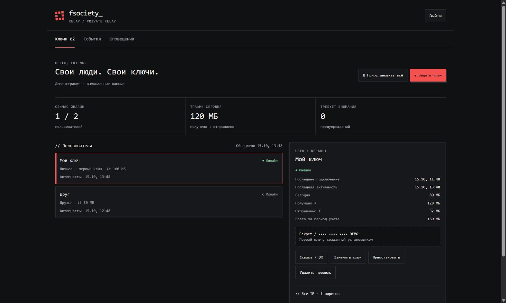

<p align="center"></p>

<p align="center">
  <a href="https://github.com/cveloy102/telegram-webproxy-panel/actions/workflows/checks.yml"></a>
  
  
  
  <a href="LICENSE"></a>
</p>

<p align="center"><b>Свой Telegram WEB-прокси для семьи и друзей.<br>Одна команда на VPS — дальше всё через браузер.</b></p>

<p align="center"><a href="#-установка">Установка</a> · <a href="#-что-получишь">Возможности</a> · <a href="docs/DNS.md">Настройка домена</a> · <a href="docs/TROUBLESHOOTING.md">Если не работает</a> · <a href="README.en.md">English</a></p>

> **Beta.** Нужен Telegram, в котором есть тип прокси **WEB**. Это отдельный тип: обычные MTProto и SOCKS5 не подойдут. Проект использует официальный proof-of-concept [telegramdesktop/tproxy-server](https://github.com/telegramdesktop/tproxy-server), а не является официальным продуктом Telegram. Работа в конкретной сети не гарантируется.

## ⚡ Установка

**Подготовь VPS и DNS-запись из следующего раздела.** Открой консоль сервера под `root` и вставь одну команду:

```bash
bash <(curl -fsSL https://raw.githubusercontent.com/cveloy102/telegram-webproxy-panel/main/install.sh)
```

Если вошёл обычным пользователем, сначала выполни `sudo -i`. Команда запускается **на VPS**, а не в командной строке твоего компьютера. Если нет `curl`, выполни `apt-get update && apt-get install -y curl python3`, затем повтори установку.

Установщик спросит:

```text
Адрес прокси: tg.example.com
Публичный IPv4: [определится автоматически]
Название страницы: [Свои люди]
Telegram для кнопки связи: [можно пропустить]
Тема страницы: [1 — пиксельная, 2 — нейтральная]
Email для сертификата: [можно пропустить]
Начать? да / нет
```

Он проверит систему, DNS и занятые порты; установит прокси, HTTPS, страницу-заглушку, веб-панель и автозапуск. Секреты генерируются на твоём сервере. Пароли от хостинга, DNS-провайдера или GitHub не нужны.

В конце появятся **ссылка на панель** и **одноразовый код владельца**:

1. Открой `https://твой-домен/control/` и введи полученный код.
2. Придумай пароль минимум из 12 символов.
3. Добавь QR в приложение-аутентификатор, введи шестизначный код.
4. Сохрани резервные коды входа. Они показываются один раз.
5. Нажми **«Выдать ключ» → «Ссылка / QR»** и передай доступ нужному человеку.

Первый профиль **«Мой ключ»** создаётся автоматически. Каждому близкому лучше выдавать отдельный профиль. Одноразовый код первого входа действует 24 часа.

## 📋 Что нужно заранее

| Что | Требование |
|---|---|
| Сервер | Отдельный чистый VPS, **Ubuntu 24.04 LTS**, **amd64 / x86_64**, systemd |
| Ресурсы | От 1 ГБ RAM; рекомендуется 2 ГБ. Минимум 2 ГБ свободного места для сборки |
| Доступ | `root` либо `sudo` |
| Сеть | Публичный IPv4; исходящий доступ к GitHub, Ubuntu, Telegram и центрам сертификации |
| Домен | Поддомен или домен с **A-записью на IP этого VPS** |
| Порты | Входящие **TCP 80 и 443** разрешены и свободны |
| Telegram | Клиент с типом прокси **WEB** |

**Не устанавливай поверх существующих сайтов, VPN или другой панели.** Установщик останавливается, если обнаруживает чужую конфигурацию или занятые порты. Debian, другие Ubuntu, ARM и контейнеры в первой версии не поддерживаются.

Пример DNS:

| Тип | Имя | Значение |
|---|---|---|
| A | `tg` | IPv4 твоего VPS |

Для домена `example.com` это создаёт адрес `tg.example.com`. Отдельно покупать поддомен не нужно. Домен и VPS могут находиться у разных компаний. Подробно: **[DNS за несколько шагов](docs/DNS.md)**.

В первой версии установщика выбранный поддомен должен иметь **один IPv4 и не иметь AAAA-записи**. В Cloudflare включи **DNS only**, без проксирования. Установщик не меняет DNS и правила firewall у хостера; их нужно подготовить самостоятельно.

## 🎛 Что получишь

| Возможность | Как работает |
|---|---|
| Выдача доступа | Именованные профили, группы «Семья», «Друзья», «Личное», ссылка и QR |
| Управление | Пауза и возобновление с прежним ключом, замена секрета, удаление с подтверждением имени |
| Общая пауза | Отключает доступ по всем ключам; сайт и панель остаются доступны |
| Подключения | Онлайн, последнее подключение и последняя активность |
| Трафик | Получено / отправлено, за сегодня и за период учёта |
| История IP | Все замеченные адреса, сгруппированные по подсетям |
| Предупреждения | Несколько подсетей одновременно и большой трафик; пороги настраиваются |
| Вход владельца | Пароль, TOTP и одноразовые резервные коды |
| Сайт | Две темы страницы, своё название и необязательная кнопка Telegram |

**Автоматических блокировок и Telegram-бота нет.** Предупреждения накапливаются в панели, решения принимает владелец. Без отдельного канала уведомлений сообщения вне панели не отправляются.



### Ограничения учёта

- До **16 активных ключей** одновременно — ограничение текущего MTProxy.
- Изменение списка ключей кратко перезапускает прокси: остальные клиенты переподключаются.
- «Онлайн» означает активность сессии за последние **90 секунд**. Данные обновляются примерно раз в 5 секунд.
- Учёт начинается с установки. Считаются байты релея без HTTP/TLS overhead, а не биллинг хостера.
- Все IP и общий трафик сохраняются; по дням — 90 дней, по часам — 48 часов, события предупреждений — 180 дней. Время — **UTC**.
- При смене сети трафик сессии относится к её последнему аутентифицированному IP. IP и подсети не доказывают утечку ключа.
- При удалении профиля его доступ отзывается. Удаление профиля не стирает все архивные данные учёта.

## 🔄 Обновление и обслуживание

Повтори ту же команду установки. Она распознает свою установку и предложит:

```text
1 — Проверить
2 — Резервная копия
3 — Обновить / продолжить установку
0 — Выход
```

Обновление сохраняет ключи, пароль, 2FA, статистику и существующую страницу. Перед переключением создаётся защищённая резервная копия. Если новые службы не запускаются, установщик пытается вернуть предыдущую версию. Проблема с внешним HTTPS после успешного запуска служб не сбрасывает данные: исправь DNS / firewall и выбери «Проверить».

| Команда на VPS | Для чего |
|---|---|
| `relay-panel status` | Состояние служб |
| `relay-panel backup` | Резервная копия ключей, настроек, базы и сертификатов |
| `relay-panel setup-code` | Новый код первого входа, **только пока владелец не создан** |

Копии хранятся в `/var/backups/relay-panel/` и содержат секреты. Скачивай их в безопасное место; не прикладывай к Issues. Инструкция по обслуживанию и восстановлению: [docs/OPERATIONS.md](docs/OPERATIONS.md).

## 🔐 Данные и безопасность

- Панель работает отдельным непривилегированным пользователем. Привилегированные операции принимает локальный Unix-сокет с проверкой пользователя процесса.
- В интернет смотрит Caddy на 80/443. Релей и панель слушают loopback; backend-порты дополнительно закрыты отдельными nftables-правилами.
- HTTPS выпускается и продлевается Caddy. Существующие firewall-правила не очищаются; порты у хостера автоматически не открываются.
- Пароли хешируются scrypt; сессионные cookie — Secure, HttpOnly, SameSite. Есть CSRF / Origin-проверки, ограничения попыток входа и защита от повторного TOTP.
- IP, счётчики, ключи и база владельца хранятся **на твоём VPS**. Встроенной аналитики и передачи этих данных автору проекта нет.
- Установка и обновления обращаются к GitHub и пакетным репозиториям; Telegram-конфигурация обновляется ежедневно. Для определения публичного IPv4 используются внешние IP-сервисы. При указании email Caddy передаёт его центру сертификации.

Не отправляй в Issues рабочие ключи, QR, коды входа, резервные копии и списки IP. См. [SECURITY.md](SECURITY.md).

## 🧰 Если что-то не работает

Начни с **[разбора частых ошибок](docs/TROUBLESHOOTING.md)**: DNS, сертификат, первый вход, отсутствие WEB в Telegram и диагностика служб.

Для сообщения об ошибке укажи версию Ubuntu, версию проекта, этап установки и текст ошибки **после удаления личных данных**. [Создать Issue](https://github.com/cveloy102/telegram-webproxy-panel/issues/new/choose).

## 🧱 Из чего состоит

```text
Telegram WEB → HTTPS :443 / Caddy → tproxy-server → MTProxy → Telegram
Браузер владельца → /control/ → Flask / Gunicorn → локальный контроллер ключей
```

| Компонент | Источник |
|---|---|
| Релей | [telegramdesktop/tproxy-server](https://github.com/telegramdesktop/tproxy-server), закреплённый commit + патч учёта |
| Backend | [TelegramMessenger/MTProxy](https://github.com/TelegramMessenger/MTProxy), закреплённый commit |
| HTTPS | [Caddy](https://caddyserver.com/), пакет Ubuntu |
| Панель | Python / Flask / Gunicorn, SQLite, локальная генерация QR |

Исходники релея и MTProxy скачиваются с проверкой SHA-256. Их версии указаны в `installer.py`. Копии твоих рабочих конфигураций для публикации не нужны. Лицензии компонентов независимы: [THIRD_PARTY.md](THIRD_PARTY.md).

## 🧪 Проверки и разработка

[GitHub Actions](https://github.com/cveloy102/telegram-webproxy-panel/actions) проверяет Python, Bash и JavaScript, тесты панели и установщика, а затем установку настоящих служб на одноразовом Ubuntu runner: локальный HTTPS, управление ключами, сохранение данных и восстановление после сбоя обновления. Сертификат в тесте выпускается локальным CA; в обычной установке используется публичный HTTPS.

Это не заменяет проверку Telegram на телефоне в конкретной сети. Известная основа проверена в частном развёртывании; универсальный установщик публикуется как **beta**.

## 📄 Лицензия

Код установщика, панели и добавленного учёта — [MIT](LICENSE). Проект не связан с Telegram и не предоставляет готовый публичный прокси: сервер и доступы принадлежат владельцу установки.
